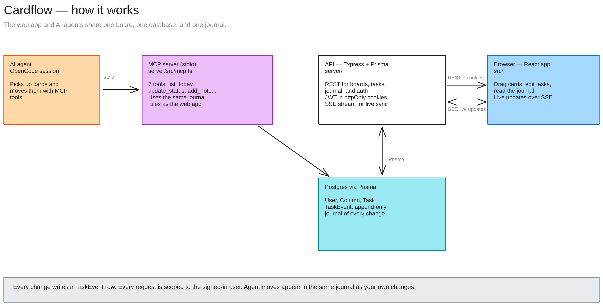

# Architecture

How Cardflow's pieces fit together. For local setup, see the README. For deploys, see DEPLOY.md.

## System shape

- The browser runs the web app (React, Vite, Tailwind) as a static build.
- The API (Express, Prisma) serves the REST routes, the SSE stream, and all auth.
- Postgres stores User, Session, Column, Task, and TaskEvent.
- The MCP server (server/src/mcp.ts) is a separate stdio process and a thin HTTP client over the API's `/api/mcp/*` routes. It holds no database client.
- An AI agent session (OpenCode) talks to the MCP server over stdio JSON-RPC.

The web app and the agent both go through the API, which scopes every query by userId, validates input, bumps SSE, and writes a journal row for every mutation.

## Data model

Defined in server/prisma/schema.prisma.

- **User.** id, email (unique), passwordHash, createdAt.
- **Session.** One row per signed-in device: userId, tokenHash (unique), createdAt, expiresAt. Sessions used to be a single column on User, which logged the first browser out whenever a second one signed in. Now they coexist, and refresh rotation touches only the row in use.
- **Column.** Exactly four per user: `kind` is one of `todo | active | review | done`, unique per user. `title` and `position` are user-editable, so a renamed or reordered list keeps its meaning. Indexed on (userId, position).
- **Task.** userId, columnId, title, description, priority, dueDate, tags[], archived, position, plus the agent fields: projectKey, gitEnabled, branch, lastCommit. The old stored agentState is gone; the API derives it from the list kind and the latest run.
- **TaskRun.** One row per agent attempt: status (claimed, running, review, completed, failed, abandoned), runner, model, branch, worktree, PR URL/number, startedAt, heartbeatAt, finishedAt, elapsedMs, error. A task can have many runs; the latest unfinished one is what the board shows.
- **TaskEvent.** The journal. userId, taskId, taskTitle, type, summary, detail?, fromColumn?, toColumn?, createdAt.

### Why TaskEvent has no foreign key to Task

A journal that loses its history when a card is deleted is useless. Entries keep a taskTitle snapshot and survive the task row, so archive and delete stay visible in the feed. Indexes on (userId, createdAt) and (taskId, createdAt) keep the feed and the per-card timeline fast.

### Event types

created, updated, moved, archived, unarchived, note, deleted, agent-started, agent-review, agent-completed, git-commit.

`updated` entries name only the fields that actually changed.

## Journal behavior

- The API writes the journal row in the same request as the mutation. The write is best effort. A journal failure is logged, and the mutation still succeeds.
- Retention: DELETE /api/board/journal/:id removes one entry. DELETE /api/board/journal with a taskId or before filter clears one card's history or prunes old entries. Tasks are never touched by these endpoints.

## Auth

- Access token: JWT, 15 minutes, in the kb_at httpOnly cookie. Refresh token: JWT, 30 days, in kb_rt. The database stores only a hash of the refresh token, and every use rotates it.
- Cookies are SameSite=Lax in development and SameSite=None; Secure in production.
- The frontend retries a request once on 401 after refreshing the session. That includes the /api/auth/me bootstrap call. Only login, register, password, and refresh itself skip the retry, because their 401s are real answers.
- Changing the password revokes every session.
- Every board and journal query is scoped by the userId from the verified token.

## Realtime

- Each mutation bumps a per-user version counter and pushes one event on GET /api/board/stream. The stream sends a ping periodically to keep proxies from closing it, and sets X-Accel-Buffering: no so nginx-style proxies do not buffer the events.
- Clients listen with EventSource. On a stream error the client refreshes its session first and then reconnects, so an idle tab with an expired access cookie recovers on its own.
- The SSE hub lives in one process. A second API replica needs a shared pub/sub channel such as Redis.

## Agent path (MCP)

- server/src/mcp.ts speaks stdio only. The API mounts the same board handlers at `/api/mcp` behind a static bearer token, so the MCP process is a thin HTTP client with no Prisma import and starts in well under a second.
- Auth: `KANBAN_MCP_TOKEN` (static, 32+ chars) in the `Authorization: Bearer` header, plus `KANBAN_MCP_USER_ID` on the server. The token names no user; the API fixes the owner from its own env. `/api/mcp/health` answers `503` until both are set.
- `board_health` checks the API, database, owner account, SSE client count and every local project root. It is the first tool to call when any other tool fails.
- Tools: board_health, list_today, list_by_date, get_task, update_status, add_note, delete_note, prune_journal.
- list_today and list_by_date skip cards in a Done-kind list, even if that list was renamed. list_by_date takes includeDone: true to see them anyway.
- update_status takes a list title. The API refuses an MCP move into a Done-kind list and tells the model to use Under Review and leave the card for a human.
- "Today" resolves in the KANBAN_TZ timezone (default Asia/Kolkata), because between 00:00 and 05:30 IST the UTC date is still yesterday.
- Project keys map to local paths through server/project-roots.json (gitignored). The MCP checks those paths locally; the API never learns them.
- Every write goes through the API, so agent moves and notes appear in the same journal and SSE stream as yours.

## Web app

- No state store. App state is useState plus optimistic updates on drag, and the board refetches after every live event.
- Design tokens live in src/index.css: radii, borders, focus ring, tabular numerals, dark mode.
- Icons are hand-drawn single-stroke SVGs in src/components/Icon.tsx. No emoji, so glyphs render the same on every platform.

## Environment variables

Server (server/.env, gitignored):

| Variable | Purpose |
| --- | --- |
| DATABASE_URL | Postgres URL for runtime queries (the Neon pooled URL in production) |
| DIRECT_URL | Postgres URL for migrations (the Neon direct URL) |
| JWT_SECRET | Signs session tokens. 32 characters minimum |
| FRONTEND_ORIGIN | Exact origin of the web app. CORS and cookies depend on it |
| PORT | HTTP port, default 4000 |
| NODE_ENV | production switches cookies to Secure and enables the strict config checks |
| KANBAN_MCP_TOKEN | Static bearer token for `/api/mcp` (32+ characters) |
| KANBAN_MCP_USER_ID | Board owner the MCP acts as |
| KANBAN_API_URL | API base the MCP calls, default http://localhost:4000 |
| KANBAN_TZ | Timezone for "today" in the MCP tools, default Asia/Kolkata |

Frontend, build time only:

| Variable | Purpose |
| --- | --- |
| VITE_API_URL | Base URL of the API, inlined into the bundle at build time |

## Diagrams

- docs/system-overview.excalidraw is the picture above. Open it on excalidraw.com to edit it.
- docs/kanban-architecture.excalidraw (and .png) is the detailed REST-path diagram: every route, table, and rule.
- docs/kanban-mcp.excalidraw (and .png) is the detailed agent-path diagram.
- Regenerate the two detailed diagrams with `python docs/gen_diagrams.py`.

## Known limits

- The auth rate limit allows 30 registration attempts and 60 login attempts per 10 minutes per IP.
- Free-tier hosts sleep after idle, so the first request can take 30 to 50 seconds.
- The SSE hub is single-process, as noted above.
